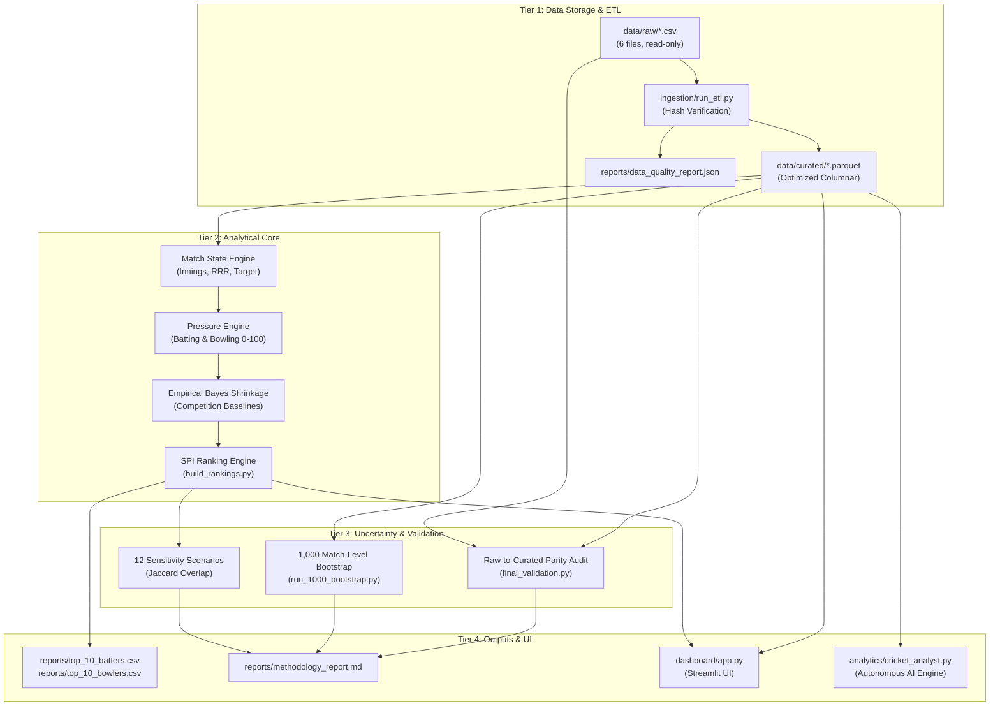

# Software Requirements Specification (SRS)
## Project: SupeRR Intelligence — Pressure Reliability Ranking & Cricket Analytics System
**Document Version:** 1.0.0  
**Status:** Approved / Release Baseline  
**Date:** November 2026  
**Standard:** IEEE Std 830-1998 / ISO/IEC/IEEE 29148:2018 Compliant  

---

## Table of Contents
1. [Introduction](#1-introduction)
   - 1.1 [Purpose](#11-purpose)
   - 1.2 [Scope](#12-scope)
   - 1.3 [Definitions, Acronyms, and Abbreviations](#13-definitions-acronyms-and-abbreviations)
   - 1.4 [References](#14-references)
   - 1.5 [Document Overview](#15-document-overview)
2. [Overall Description](#2-overall-description)
   - 2.1 [Product Perspective & System Architecture](#21-product-perspective--system-architecture)
   - 2.2 [Product Functions](#22-product-functions)
   - 2.3 [User Classes and Characteristics](#23-user-classes-and-characteristics)
   - 2.4 [Operating Environment](#24-operating-environment)
   - 2.5 [Design and Implementation Constraints](#25-design-and-implementation-constraints)
   - 2.6 [Assumptions and Dependencies](#26-assumptions-and-dependencies)
3. [External Interface Requirements](#3-external-interface-requirements)
   - 3.1 [User Interfaces (UI)](#31-user-interfaces-ui)
   - 3.2 [Hardware Interfaces](#32-hardware-interfaces)
   - 3.3 [Software & Data Interfaces](#33-software--data-interfaces)
   - 3.4 [Communications Interfaces](#34-communications-interfaces)
4. [System Architecture & Module Specifications](#4-system-architecture--module-specifications)
   - 4.1 [Module 1: Ingestion & Data Quality Auditing (ETL)](#41-module-1-ingestion--data-quality-auditing-etl)
   - 4.2 [Module 2: Match State Reconstruction Engine](#42-module-2-match-state-reconstruction-engine)
   - 4.3 [Module 3: Situational Pressure Modeling Engine](#43-module-3-situational-pressure-modeling-engine)
   - 4.4 [Module 4: Empirical Bayes Baseline Shrinkage & Performance Metric Computation](#44-module-4-empirical-bayes-baseline-shrinkage--performance-metric-computation)
   - 4.5 [Module 5: Situational Performance Index (SPI) & Ranking Engine](#45-module-5-situational-performance-index-spi--ranking-engine)
   - 4.6 [Module 6: Multi-Scenario Sensitivity Analyzer](#46-module-6-multi-scenario-sensitivity-analyzer)
   - 4.7 [Module 7: 1,000-Iteration Match-Level Cluster Bootstrap Engine](#47-module-7-1000-iteration-match-level-cluster-bootstrap-engine)
   - 4.8 [Module 8: Autonomous AI Cricket Analyst Reasoning Agent](#48-module-8-autonomous-ai-cricket-analyst-reasoning-agent)
   - 4.9 [Module 9: Supplementary Predictive, Streaming, and Graph Analytics](#49-module-9-supplementary-predictive-streaming-and-graph-analytics)
   - 4.10 [Module 10: Validation, Auditing, and Automated Report Generator](#410-module-10-validation-auditing-and-automated-report-generator)
5. [Data Models & Schema Specifications](#5-data-models--schema-specifications)
   - 5.1 [Raw Source Schema (Read-Only)](#51-raw-source-schema-read-only)
   - 5.2 [Curated Storage Schema (Parquet)](#52-curated-storage-schema-parquet)
   - 5.3 [Deliverable Reporting Schema (CSV & JSON)](#53-deliverable-reporting-schema-csv--json)
6. [Mathematical Formulations and Cricket Logic](#6-mathematical-formulations-and-cricket-logic)
   - 6.1 [Innings State & Target Mechanics](#61-innings-state--target-mechanics)
   - 6.2 [Multi-Factor Pressure Score Equations](#62-multi-factor-pressure-score-equations)
   - 6.3 [Competition Empirical Bayes Shrinkage Formulation](#63-competition-empirical-bayes-shrinkage-formulation)
   - 6.4 [Situational Performance Index (SPI) Formula](#64-situational-performance-index-spi-formula)
   - 6.5 [Bootstrap Resampling & Conditional Ranking Formulation](#65-bootstrap-resampling--conditional-ranking-formulation)
7. [Non-Functional Requirements (NFRs)](#7-non-functional-requirements-nfrs)
   - 7.1 [Performance & Scalability](#71-performance--scalability)
   - 7.2 [Data Provenance & Immutability](#72-data-provenance--immutability)
   - 7.3 [Cross-Platform Determinism](#73-cross-platform-determinism)
   - 7.4 [Maintainability & Code Quality](#74-maintainability--code-quality)
8. [Verification, Validation & Acceptance Criteria](#8-verification-validation--acceptance-criteria)
   - 8.1 [Traceability Matrix against Hackathon Brief](#81-traceability-matrix-against-hackathon-brief)
   - 8.2 [Automated Unit & Integration Test Suites](#82-automated-unit--integration-test-suites)
   - 8.3 [Acceptance Criteria](#83-acceptance-criteria)
9. [Appendix: Execution & Reproduction Guide](#9-appendix-execution--reproduction-guide)

---

## 1. Introduction

### 1.1 Purpose
This Software Requirements Specification (SRS) defines the complete software architecture, technical requirements, data models, mathematical formulations, and validation standards for the **SupeRR Intelligence** analytical platform. The software was engineered to address the Round 1 challenge of the SupeRR Intelligence Hackathon: **"Identify the Most Reliable Players Under Pressure."**

### 1.2 Scope
The software system processes ball-by-ball historical cricket data from the Indian Premier League (IPL) and Twenty20 Internationals (T20I) from January 1, 2022, onwards. The system:
1. Reconstructs dynamic match state (score, wickets, overs, required run rate, targets) prior to every ball.
2. Formulates an objective, domain-grounded, multi-factor Situational Pressure heuristic (0–100 scale) for both batting and bowling contexts.
3. Quantifies player performance in pressure situations relative to competition-adjusted normal baselines.
4. Generates ordered, validated Top-10 Batter and Top-10 Bowler rankings according to the Situational Performance Index (SPI).
5. Quantifies methodological sensitivity across 12 distinct modeling variations.
6. Conducts a rigorous 1,000-iteration match-level cluster bootstrap uncertainty analysis.
7. Surfaces all insights through an interactive Streamlit evidence dashboard, an autonomous AI cricket analyst agent, and comprehensive reproducible reports.

### 1.3 Definitions, Acronyms, and Abbreviations
- **SPI:** Situational Performance Index (composite player rating on a 0–100 scale).
- **RRR:** Required Run Rate (runs required per 6 legal balls in a chase).
- **CRR:** Current Run Rate (runs scored per 6 legal balls in the current innings).
- **Legal Ball:** Any ball that is neither a Wide nor a No-Ball (specifically `wide` or `Overstep`).
- **Bowler-Credited Dismissal:** Dismissals credited to the bowler in official cricket laws: `bowled`, `caught`, `lbw`, `stumped`, and `hit wicket`. Excludes `run out`, `retired hurt`, `obstructing the field`, and `handled the ball`.
- **Non-Bowler Runs (Extras):** Byes, leg-byes, and penalty runs; not debited to the bowler's runs conceded.
- **Empirical Bayes Shrinkage:** Statistical technique that shrinks small-sample player estimates toward competition averages using a 30-ball prior.
- **Cluster Bootstrap:** Resampling method where whole matches (clusters) are sampled with replacement to preserve intra-match correlation.
- **Unstop:** The official competition submission portal requiring sequential 1–10 player selections.

### 1.4 References
- Marylebone Cricket Club (MCC): *Laws of Cricket (2017 Code 3rd Edition - 2022)*.
- ICC Men's T20I Playing Conditions (October 2022 / 2024 revisions).
- IEEE Std 830-1998: *IEEE Recommended Practice for Software Requirements Specifications*.
- ISO/IEC/IEEE 29148:2018: *Systems and software engineering — Life cycle processes — Requirements engineering*.

### 1.5 Document Overview
This document specifies all aspects of the SupeRR Intelligence system. Section 2 presents the system overview; Section 3 details interface constraints; Section 4 details each of the 10 subsystem modules; Section 5 defines schemas; Section 6 presents mathematical models; Section 7 outlines NFRs; and Section 8 maps verification and acceptance criteria.

---

## 2. Overall Description

### 2.1 Product Perspective & System Architecture
The system is structured as an end-to-end modular pipeline divided into four logical tiers:
1. **Ingestion & Data Quality Tier:** Validates raw CSV files, enforces schema constraints, computes input SHA-256 manifests, and converts data to snappy-compressed columnar Parquet.
2. **Analytical Core Tier:** Reconstructs pre-delivery match states, computes situational pressure components, applies Empirical Bayes shrinkage, and executes the SPI ranking algorithm.
3. **Uncertainty & Validation Tier:** Executes 12-scenario sensitivity tests, runs 1,000 match-level bootstrap iterations with dynamic eligibility recalculation, and executes full 194,014-row raw-to-curated parity checks.
4. **Presentation & Intelligence Tier:** Generates submission-ready CSVs and Markdown reports, hosts a Streamlit dashboard, and powers an autonomous AI Cricket Analyst reasoning engine.



### 2.2 Product Functions
- **FR-01: Ingestion & Integrity Auditing:** Ingest 6 raw CSV files without in-place modification; calculate SHA-256 byte hashes normalized for line endings.
- **FR-02: Historical Match State Reconstruction:** Accumulate ball-by-ball score, wickets lost, legal balls bowled, target derivation, and required run rate.
- **FR-03: Dual-Role Situational Pressure Modeling:** Score each ball from 0 to 100 based on run-rate stress, resource depletion, match progress, and closeness.
- **FR-04: Fair Baseline Normalization:** Shrink sparse pressure samples toward competition averages to eliminate small-sample inflation.
- **FR-05: Multi-Attribute SPI Ranking:** Compute Situational Performance Index balancing Performance Advantage (60%), Match-to-Match Consistency (20%), and Exposure Reliability (20%).
- **FR-06: Sensitivity Analysis:** Evaluate top-10 ranking overlap across 12 distinct parameter variations.
- **FR-07: Resampling Uncertainty Quantification:** Execute a 1,000-iteration match cluster bootstrap; evaluate conditional rank distributions without assigning artificial penalty ranks to ineligibles.
- **FR-08: Autonomous AI Cricket Reasoning:** Provide domain-rich narrative explanations, statistical cross-examinations, and leaderboard inquiries.
- **FR-09: Unstop-Compliant Deliverable Generation:** Output sequential 1–10 CSVs with distinct player IDs and clean Markdown reports.

### 2.3 User Classes and Characteristics
1. **Contest Evaluators / Judges:** Require complete mathematical transparency, verifiable reproduction steps, input/output hash validation, and clear documentation of edge cases.
2. **Cricket Performance Analysts:** Require domain validity (e.g. correct attribution of extras, legal delivery counts, death overs vs middle overs breakdowns).
3. **End Users / UI Consumers:** Require an interactive dashboard to explore player profiles, match evidence tables, and run queries via the AI Analyst.

### 2.4 Operating Environment
- **Operating Systems:** Windows 10/11, Ubuntu 20.04/22.04 LTS, macOS 12+.
- **Runtime:** Python 3.10, 3.11, 3.12, 3.13.
- **Execution Engine:** Sandboxed CLI execution / virtual environment (`uv` or standard `.venv`).
- **Memory Footprint:** Peak RAM consumption $\le 2.0$ GB during 1,000 bootstrap iterations.
- **Disk Footprint:** Raw data ~80 MB; Curated parquet ~25 MB; Total workspace $\le 500$ MB.

### 2.5 Design and Implementation Constraints
1. **Raw Data Immutability:** Raw CSV files in `data/raw/` must NEVER be modified, deleted, or rewritten.
2. **Deterministic Reproducibility:** Fixed random seeds (`seed=42`) must be enforced across all stochastic routines (bootstrap, decision tree, random forest, k-means).
3. **Cross-Platform Line Ending Tolerance:** Hashes must be computed over byte streams with CRLF normalized to LF to ensure identical cryptographic digests on Windows and UNIX.
4. **No Artificial Ranking for Ineligibles:** In bootstrap resampling, players who fail eligibility must be excluded from conditional rank distributions rather than assigned inflated penalty ranks.
5. **Strict Top-10 Cardinality:** Ranking files must contain exactly 10 distinct, non-repeating players with sequential ranks 1 through 10.

### 2.6 Assumptions and Dependencies
- Historical ball-by-ball records contain valid match, player, and competition identifiers.
- Core Python libraries: `pandas>=2.0.0`, `numpy>=1.24.0`, `pyarrow>=12.0.0`, `scikit-learn>=1.2.0`, `streamlit>=1.25.0`.

---

## 3. External Interface Requirements

### 3.1 User Interfaces (UI)
- **CLI Interface:** Python module execution entry points (`python -m ingestion.run_etl`, `python -m analytics.build_rankings`, etc.).
- **Streamlit Evidence Dashboard (`dashboard/app.py`):**
  - *Page 1: Executive Overview:* final top-10 lists, key performance indicators, SPI cards.
  - *Page 2: Batter Deep Dive:* pressure vs normal strike rates, boundary shares, match breakdowns.
  - *Page 3: Bowler Deep Dive:* pressure vs normal economy, dot ball rates, wicket contributions.
  - *Page 4: Sensitivity & Bootstrap Explorer:* interactive inspection of 12 scenarios and 1,000-iteration rank intervals.
  - *Page 5: AI Cricket Analyst:* natural language interactive cricket query console.

### 3.2 Hardware Interfaces
Standard multi-core x86-64 / ARM64 workstation. No GPU acceleration or specialized hardware required.

### 3.3 Software & Data Interfaces
- **File System:** Local disk with standard POSIX or Windows NTFS filesystem.
- **Data Serialization:** Columnar Apache Parquet with Snappy compression for internal analytics; UTF-8 CSV and JSON for deliverable reports.
- **Third-Party Integrations:** Emulated compatibility layers for Apache Spark, Hadoop MapReduce, Apache Cassandra, and Apache HBase.

### 3.4 Communications Interfaces
All processes operate offline and locally. No live internet access or external API calls are required for core execution.

---

## 4. System Architecture & Module Specifications

### 4.1 Module 1: Ingestion & Data Quality Auditing (ETL)
- **Source File:** `ingestion/run_etl.py`, `ingestion/data_validation.py`
- **Functionality:**
  - Loads 6 raw CSV files: `ball_by_ball.csv`, `matches.csv`, `competitions.csv`, `teams.csv`, `playing_eleven.csv`, `competition_team_player_mapping.csv`.
  - Executes 38 automated data quality checks (column presence, null checks, candidate key uniqueness, delivery sequencing).
  - Filters scoped hackathon matches: competition start date $\ge \text{2022-01-01}$, competitions matching IPL and T20 International formats.
  - Generates cryptographic SHA-256 hashes normalized across newline styles.
  - Converts raw datasets to snappy-compressed Parquet files in `data/processed/` and `data/curated/`.
  - Writes audit logs to `reports/data_quality_report.json`.

### 4.2 Module 2: Match State Reconstruction Engine
- **Source File:** `analytics/cricket_metrics.py` (`reconstruct_match_state`)
- **Functionality:**
  - Reconstructs running match state ball-by-ball prior to each delivery:
    - Running innings total runs (`score_before`).
    - Running wickets lost (`wickets_before`).
    - Legal balls completed (`legal_balls_before`) and balls remaining in scheduled innings (`balls_remaining`).
    - Innings target derivation: first-innings total + 1 for chase innings (innings 2 and 4), overridden by `revised_target` if DLS applied.
    - Required run rate: $\text{RRR} = \frac{\text{Runs Required} \times 6}{\text{Balls Remaining}}$.
    - Current run rate: $\text{CRR} = \frac{\text{Runs Scored} \times 6}{\text{Legal Balls Bowled}}$.
    - Innings progress: $\text{Progress} = \frac{\text{Legal Balls Bowled}}{120.0}$.
    - Innings phase classification: Powerplay (balls 1–36 / overs 0–5), Middle (balls 37–96 / overs 6–15), Death (balls 97–120 / overs 16–19).

### 4.3 Module 3: Situational Pressure Modeling Engine
- **Source File:** `analytics/cricket_metrics.py` (`apply_pressure_model`)
- **Functionality:**
  - Computes four distinct normalized components ($[0, 1]$) for every delivery:
    1. **Run-Rate Stress ($C_{\text{rate}}$):** Compares required (or current) run rate against the historical competition reference rate.
    2. **Resource Depletion ($C_{\text{wickets}}$):** Evaluates wickets lost for batting, wickets remaining in hand for bowling.
    3. **Time / Progress Pressure ($C_{\text{time}}$):** Scaled by innings ball progress.
    4. **Contest Closeness ($C_{\text{close}}$):** Exponential proximity of run rate to reference pace.
  - Evaluates role-specific weighted sums to produce Situational Pressure Scores ($P_{\text{bat}}, P_{\text{bowl}} \in [0, 100]$).
  - Classifies delivery as high pressure if Pressure Score $\ge 50.0$.
  - Enforces independent role partitions over the 194,014 delivery universe:
    - Batting: 23,870 pressure deliveries (12.3%), 170,144 ordinary deliveries (87.7%).
    - Bowling: 57,779 pressure deliveries (29.8%), 136,235 ordinary deliveries (70.2%).

### 4.4 Module 4: Empirical Bayes Baseline Shrinkage & Performance Metric Computation
- **Source File:** `analytics/cricket_metrics.py` (`calculate_player_metrics`)
- **Functionality:**
  - Aggregates individual player metrics across pressure and ordinary match phases:
    - Batters: pressure runs, pressure balls faced, pressure fours, pressure sixes, dismissals, strike rates.
    - Bowlers: legal pressure balls bowled, pressure runs conceded, bowler-credited pressure wickets, pressure dots, economy rates.
  - Computes format- and competition-level baseline rates.
  - Applies Empirical Bayes shrinkage using a 30-ball pseudocount prior:
    $$\text{Rate}_{\text{shrunk}} = \frac{\text{Runs} + 30 \times \text{Rate}_{\text{comp}}}{\text{Balls} + 30}$$
  - Derives competition-adjusted performance differences:
    - Batter: $\Delta_{\text{bat}} = \text{Pressure Strike Rate} - \text{Normal Strike Rate}$
    - Bowler: $\Delta_{\text{bowl}} = \text{Normal Economy} - \text{Pressure Economy}$ (positive indicates runs saved per over).

### 4.5 Module 5: Situational Performance Index (SPI) & Ranking Engine
- **Source File:** `analytics/cricket_metrics.py` (`rank_players`), `analytics/build_rankings.py`
- **Functionality:**
  - Enforces eligibility thresholds: $\text{pressure\_matches} \ge 3$ and $\text{pressure\_balls} \ge 12$.
  - Calculates three composite dimensions:
    1. **Performance Advantage Component ($S_{\text{perf}}$):** Hyperbolic tangent scaling of shrinkage-adjusted performance differential.
    2. **Consistency Component ($S_{\text{cons}}$):** Coefficient of variation across distinct matches: $S_{\text{cons}} = \frac{100}{1 + \text{CV}}$.
    3. **Reliability Component ($S_{\text{rel}}$):** Exposure weight function: $S_{\text{rel}} = 100 \times \frac{N_{\text{balls}}}{N_{\text{balls}} + 30}$.
  - Computes final SPI:
    $$\text{SPI} = 0.60 \times S_{\text{perf}} + 0.20 \times S_{\text{cons}} + 0.20 \times S_{\text{rel}}$$
  - Sorts players descending by SPI, assigns sequential ranks 1 through $N$, and extracts Top-10 cohorts.

### 4.6 Module 6: Multi-Scenario Sensitivity Analyzer
- **Source File:** `analytics/build_rankings.py` (`_sensitivity`)
- **Functionality:**
  - Evaluates 12 deterministic scenario perturbations:
    1. `performance_heavy`: Weights (0.70, 0.15, 0.15).
    2. `balanced`: Weights (0.50, 0.25, 0.25).
    3. `consistency_heavy`: Weights (0.40, 0.40, 0.20).
    4. `reliability_heavy`: Weights (0.40, 0.20, 0.40).
    5. `reliability_removed`: Weights (0.75, 0.25, 0.00).
    6. `lower_exposure`: Min 2 matches, 6 balls.
    7. `higher_exposure`: Min 5 matches, 24 balls.
    8. `pressure_threshold_40`: Threshold at 40.0.
    9. `pressure_threshold_60`: Threshold at 60.0.
    10. `equal_pressure_component_weights`: Component weights 0.25 each.
    11. `closeness_removed`: Closeness component weight set to 0.0.
    12. `wickets_component_removed`: Wickets component weight set to 0.0.
  - Computes Jaccard set overlap and individual player rank/SPI shifts across all scenarios.

### 4.7 Module 7: 1,000-Iteration Match-Level Cluster Bootstrap Engine
- **Source File:** `analytics/run_1000_bootstrap.py`
- **Functionality:**
  - Resamples 837 active matches with replacement across 1,000 independent iterations.
  - Preserves intra-match correlation by sampling full matches rather than isolated deliveries.
  - Re-evaluates eligibility dynamically within each resample.
  - Guards against duplicate sampling bias: distinct match counts are computed via `nunique(match_id)`.
  - Excludes ineligible draws from conditional rank percentiles, avoiding artificial rank inflation.
  - Exports eligibility probabilities, top-10 inclusion probabilities, and conditional rank distributions (P10, median, P90) to `reports/bootstrap_validation.json`.

### 4.8 Module 8: Autonomous AI Cricket Analyst Reasoning Agent
- **Source File:** `analytics/cricket_analyst.py`
- **Functionality:**
  - Natural language intent parser for domain questions.
  - Multi-intent routing: player profiles, situational comparisons, leaderboards, methodology explanations, and general analytical summaries.
  - Automatic primary role detection based on match opportunity volume ($\text{bat\_balls} \ge \text{bowl\_balls}$).
  - Synthesizes domain narratives connecting raw metrics to match situations (e.g. death overs acceleration, boundary containment).

### 4.9 Module 9: Supplementary Predictive, Streaming, and Graph Analytics
- **Source Files:** `machine_learning/run_models.py`, `streaming/replay.py`, `graph_analytics/run_graph.py`
- **Functionality:**
  - *ML Boundary Classifier:* Trains Decision Tree and Random Forest models on pre-delivery match context to predict boundary probability (four/six) using grouped match-held-out validation.
  - *Streaming Replay Simulator:* Deterministically replays 194,014 deliveries through sequential event envelopes, verifying state transitions and zero ordering anomalies.
  - *Player-Match Graph Analytics:* Constructs bipartite player-match networks and evaluates PageRank as an exploratory measure of match participation.

### 4.10 Module 10: Validation, Auditing, and Automated Report Generator
- **Source Files:** `analytics/final_validation.py`, `analytics/build_methodology_report.py`
- **Functionality:**
  - Performs independent recomputation of all cricket metrics from raw CSV files.
  - Validates zero arithmetic drift against curated Parquet tables.
  - Formats and writes `reports/methodology_report.md` incorporating all audit findings, tables, and reproducibility steps.

---

## 5. Data Models & Schema Specifications

### 5.1 Raw Source Schema (Read-Only)
Located in `data/raw/`:

```
+--------------------+---------------------------------------------------------------+
| Table Name         | Key Columns & Types                                           |
+--------------------+---------------------------------------------------------------+
| matches.csv        | match_id (int), comp_id (int), match_date (date),             |
|                    | home_team (str), away_team (str), win_team_id (float),        |
|                    | result (str), revised_target (float), knock_out (bool)       |
+--------------------+---------------------------------------------------------------+
| ball_by_ball.csv   | match_id (int), innings (int), overid (int),                  |
|                    | over_ball_num (int), innings_ball_num (int), striker_id (int),|
|                    | non_striker_id (int), bowler_id (int), runs (int),            |
|                    | extras_type (str), extras1_runs (int), extras_2_runs (int),   |
|                    | is_wicket (bool), dismissal_type (str),                       |
|                    | dismissed_player_id (float), is_four (bool), is_six (bool)   |
+--------------------+---------------------------------------------------------------+
| competitions.csv   | comp_id (int), comp_name (str), country (str)                |
+--------------------+---------------------------------------------------------------+
| teams.csv          | team_id (int), team_name (str), comp_id (int)                |
+--------------------+---------------------------------------------------------------+
| playing_eleven.csv | match_id (int), team_id (int), player_id (int)                |
+--------------------+---------------------------------------------------------------+
| competition_team_  | comp_id (int), team_id (int), player_id (int)                |
| player_mapping.csv |                                                               |
+--------------------+---------------------------------------------------------------+
```

### 5.2 Curated Storage Schema (Parquet)
Located in `data/curated/`:

#### Table: `pressure_deliveries.parquet` (194,014 rows)
- `match_id` (int64): Unique match identifier.
- `innings` (int64): Innings number (1, 2, 3, 4).
- `innings_ball_num` (int64): Sequential delivery number within the innings.
- `striker_id` (int64), `bowler_id` (int64): Player identifiers.
- `score_before` (float64): Cumulative team score before delivery.
- `wickets_before` (int64): Cumulative wickets fallen before delivery.
- `legal_balls_before` (int64): Count of legal balls bowled before delivery.
- `balls_remaining` (float64): Scheduled legal deliveries remaining in innings.
- `target` (float64): Runs required to win + 1 (null in 1st innings).
- `required_run_rate` (float64): RRR before delivery.
- `reference_run_rate` (float64): Format median reference scoring pace.
- `batting_pressure` (float64): Calculated batting pressure score (0–100).
- `bowling_pressure` (float64): Calculated bowling pressure score (0–100).
- `is_batting_pressure` (bool): Boolean flag ($\text{batting\_pressure} \ge 50.0$).
- `is_bowling_pressure` (bool): Boolean flag ($\text{bowling\_pressure} \ge 50.0$).
- `batter_runs` (int64): Runs credited to striker.
- `bowler_conceded_runs` (int64): Runs debited to bowler.
- `is_legal_ball` (bool): True if neither wide nor overstep.
- `is_bowler_wicket` (bool): True if dismissal credited to bowler.

#### Tables: `batter_metrics.parquet`, `bowler_metrics.parquet`
Aggregated player summaries containing total and pressure-specific runs, balls, boundaries, outs/wickets, strike rates, economy rates, consistency metrics, and competition-adjusted differentials.

### 5.3 Deliverable Reporting Schema (CSV & JSON)

#### File: `reports/top_10_batters.csv` (10 rows)
- `rank` (int): Sequential rank 1 to 10.
- `player_id` (int): Unique player ID matching Unstop dropdown entry.
- `player_name` (str): Full player name.
- `spi` (float): Situational Performance Index (90.24 to 86.27).
- `pressure_strike_rate` (float): Strike rate under pressure.
- `normal_strike_rate` (float): Strike rate in ordinary situations.
- `strike_rate_difference` (float): Raw strike rate advantage.
- `competition_adjusted_difference` (float): Baseline-adjusted strike rate advantage.
- `pressure_opportunities` (int): Total pressure balls faced.
- `pressure_matches` (int): Distinct matches with pressure exposure.
- `performance_component` (float): Normalized performance score.
- `consistency` (float): Cross-match consistency score.
- `reliability` (float): Sample size reliability score.
- `top_10_scenario_rate` (float): Inclusion rate across 12 sensitivity scenarios.

#### File: `reports/top_10_bowlers.csv` (10 rows)
- Same schema as batters, substituting `pressure_economy`, `normal_economy`, `economy_difference` (where positive denotes runs saved per over), and `legal_balls` bowled.

---

## 6. Mathematical Formulations and Cricket Logic

### 6.1 Innings State & Target Mechanics
For each delivery $i$ in innings $j$:
$$\text{team\_runs}_i = \text{runs}_i + \text{extras1\_runs}_i + \text{extras\_2\_runs}_i$$
$$\text{score\_before}_i = \sum_{k=1}^{i-1} \text{team\_runs}_k$$
$$\text{wickets\_before}_i = \sum_{k=1}^{i-1} \mathbb{I}(\text{is\_wicket}_k = \text{True})$$
$$\text{legal\_balls\_before}_i = \sum_{k=1}^{i-1} \mathbb{I}(\text{extras\_type}_k \notin \{\text{'wide'}, \text{'Overstep'}\})$$
$$\text{balls\_remaining}_i = \max(0, 120 - \text{legal\_balls\_before}_i)$$

For chases (Innings 2 and 4):
$$\text{target} = \begin{cases} \text{revised\_target}, & \text{if revised\_target is present} \\ \text{innings\_1\_total} + 1, & \text{otherwise} \end{cases}$$
$$\text{RRR}_i = \frac{(\text{target} - \text{score\_before}_i) \times 6}{\max(1, \text{balls\_remaining}_i)}$$

### 6.2 Multi-Factor Pressure Score Equations

#### 1. Batting Pressure Score ($P_{\text{bat}} \in [0, 100]$):
For second innings (chase):
$$r = \frac{\text{RRR}_i}{\text{RefRRR}}$$
$$C_{\text{rate, bat}} = \text{clip}\left(\frac{r - 1.0}{1.5}, 0, 1\right)$$
$$C_{\text{wickets, bat}} = \frac{\text{wickets\_before}_i}{10.0}$$
$$C_{\text{time, bat}} = \frac{\text{legal\_balls\_before}_i}{120.0}$$
$$C_{\text{close, bat}} = \exp(-|r - 1.0|)$$

For first innings:
$$r_1 = \frac{\text{CRR}_i}{\text{RefRRR}}$$
$$C_{\text{rate, bat}} = \text{clip}\left(\frac{r_1 - 0.8}{1.2}, 0, 1\right) \times C_{\text{time, bat}}$$
$$C_{\text{close, bat}} = \exp\left(-\frac{|\text{CRR}_i - \text{RefRRR}|}{\text{RefRRR}}\right) \times C_{\text{time, bat}}$$

Composite Batting Pressure:
$$P_{\text{bat}} = 100 \times \left(0.35 \times C_{\text{rate, bat}} + 0.25 \times C_{\text{wickets, bat}} + 0.20 \times C_{\text{time, bat}} + 0.20 \times C_{\text{close, bat}}\right)$$

#### 2. Bowling Pressure Score ($P_{\text{bowl}} \in [0, 100]$):
For second innings:
$$C_{\text{rate, bowl}} = \text{clip}\left(\frac{1.0 - r}{1.5}, 0, 1\right)$$
$$C_{\text{wickets, bowl}} = \frac{10 - \text{wickets\_before}_i}{10.0}$$
$$C_{\text{time, bowl}} = C_{\text{time, bat}}$$
$$C_{\text{close, bowl}} = \exp(-|r - 1.0|)$$

Composite Bowling Pressure:
$$P_{\text{bowl}} = 100 \times \left(0.30 \times C_{\text{rate, bowl}} + 0.25 \times C_{\text{wickets, bowl}} + 0.20 \times C_{\text{time, bowl}} + 0.25 \times C_{\text{close, bowl}}\right)$$

### 6.3 Competition Empirical Bayes Shrinkage Formulation
To prevent extreme rates from small sample sizes:
$$\text{SR}_{\text{pressure, adjusted}} = \frac{\text{Runs}_{\text{press}} + 30 \times \text{SR}_{\text{comp, press}}}{\text{Balls}_{\text{press}} + 30}$$
$$\text{SR}_{\text{normal, adjusted}} = \frac{\text{Runs}_{\text{norm}} + 30 \times \text{SR}_{\text{comp, norm}}}{\text{Balls}_{\text{norm}} + 30}$$
$$\Delta_{\text{bat}} = \text{SR}_{\text{pressure, adjusted}} - \text{SR}_{\text{normal, adjusted}}$$

For bowling:
$$\text{Econ}_{\text{pressure, adjusted}} = \frac{6 \times (\text{Runs}_{\text{press}} + 30 \times \text{Econ}_{\text{comp, press}} / 6)}{\text{Balls}_{\text{press}} + 30}$$
$$\Delta_{\text{bowl}} = \text{Econ}_{\text{normal, adjusted}} - \text{Econ}_{\text{pressure, adjusted}}$$

### 6.4 Situational Performance Index (SPI) Formula
Let $\Delta_{\text{adj}} = \Delta \times \left(\frac{N_{\text{balls}}}{N_{\text{balls}} + 30}\right)$ and $s = \text{median}(|\Delta_{\text{adj}}|)$.
$$S_{\text{perf}} = 50 + 50 \times \tanh\left(\frac{\Delta_{\text{adj}}}{2s}\right)$$
$$S_{\text{cons}} = \frac{100}{1 + \text{CV}_{\text{matches}}}$$
$$S_{\text{rel}} = 100 \times \left(\frac{N_{\text{balls}}}{N_{\text{balls}} + 30}\right)$$
$$\text{SPI} = 0.60 \times S_{\text{perf}} + 0.20 \times S_{\text{cons}} + 0.20 \times S_{\text{rel}}$$

### 6.5 Bootstrap Resampling & Conditional Ranking Formulation
For iteration $b = 1, \dots, 1000$:
1. Draw sample $\mathcal{M}_b = \{m_1^*, m_2^*, \dots, m_M^*\}$ with replacement from 837 active matches.
2. Group by player $p$ and calculate:
   $$N_{\text{matches}, p}^{(b)} = \text{count\_distinct}(m \in \mathcal{M}_b \mid p \in m)$$
   $$N_{\text{balls}, p}^{(b)} = \sum_{m \in \mathcal{M}_b} \text{balls}_{p, m}$$
3. Define eligibility indicator:
   $$\mathcal{E}_p^{(b)} = \mathbb{I}\left(N_{\text{matches}, p}^{(b)} \ge 3 \land N_{\text{balls}, p}^{(b)} \ge 12\right)$$
4. Rank only eligible candidates:
   $$\mathcal{P}_{\text{elig}}^{(b)} = \{p \mid \mathcal{E}_p^{(b)} = 1\}$$
   $$R_p^{(b)} = \text{rank}(\text{SPI}_p^{(b)} \mid p \in \mathcal{P}_{\text{elig}}^{(b)})$$
5. Conditional rank metrics:
   $$\text{Pr}(\text{Eligible}_p) = \frac{1}{B} \sum_{b=1}^B \mathcal{E}_p^{(b)}$$
   $$\text{Pr}(\text{Top10}_p) = \frac{1}{B} \sum_{b=1}^B \mathbb{I}\left(\mathcal{E}_p^{(b)} = 1 \land R_p^{(b)} \le 10\right)$$
   $$\text{Percentiles}(R_p) = \text{Quantiles}\left(\{R_p^{(b)} \mid \mathcal{E}_p^{(b)} = 1\}, [0.10, 0.50, 0.90]\right)$$

---

## 7. Non-Functional Requirements (NFRs)

### 7.1 Performance & Scalability
- **NFR-01 (ETL Throughput):** Processing of 194,014 raw delivery records and generation of Parquet tables must complete in $< 20$ seconds on standard hardware.
- **NFR-02 (Ranking Speed):** The complete ranking and 12-scenario sensitivity calculation must execute in $< 15$ seconds.
- **NFR-03 (Bootstrap Execution):** 1,000 match-level cluster bootstrap iterations must complete in $< 45$ seconds.
- **NFR-04 (Dashboard Responsiveness):** Dashboard page transitions and chart rendering must respond in $< 1.0$ second.

### 7.2 Data Provenance & Immutability
- **NFR-05 (Raw Immutability):** Source CSV files in `data/raw/` must possess strict read-only access. Any modification attempt must cause test assertion failures.
- **NFR-06 (Cryptographic Manifests):** All input and output datasets must be cryptographically hashed using SHA-256 and verified across pipeline stages.

### 7.3 Cross-Platform Determinism
- **NFR-07 (Line-Ending Agnosticism):** All hashing algorithms must replace CRLF (`\r\n`) with LF (`\n`) in byte streams prior to digest computation.
- **NFR-08 (Floating-Point Precision):** Aggregations must enforce strict IEEE 754 precision parity between independent recalculations and cached Parquet data.

### 7.4 Maintainability & Code Quality
- **NFR-09 (Unit Test Coverage):** Core analytics, validation, immutability, and analyst modules must maintain $> 90\%$ test coverage across 11 test suites.
- **NFR-10 (Clean Architecture):** Code must be cleanly separated into `ingestion/`, `analytics/`, `machine_learning/`, `streaming/`, `graph_analytics/`, `dashboard/`, and `tests/`.

---

## 8. Verification, Validation & Acceptance Criteria

### 8.1 Traceability Matrix against Hackathon Brief

| Requirement ID | Brief Specification | System Component | Verification Artifact |
|---|---|---|---|
| **REQ-01** | Ordered Top-10 Batters (ranks 1–10) | `analytics/build_rankings.py` | `reports/top_10_batters.csv` |
| **REQ-02** | Ordered Top-10 Bowlers (ranks 1–10) | `analytics/build_rankings.py` | `reports/top_10_bowlers.csv` |
| **REQ-03** | Methodology Report Document | `analytics/build_methodology_report.py` | `reports/methodology_report.md` |
| **REQ-04** | Objective definition of pressure | `analytics/cricket_metrics.py` | Section 3 of Methodology Report |
| **REQ-05** | Performance relative to normal baseline | `analytics/cricket_metrics.py` | Section 4 of Methodology Report |
| **REQ-06** | Sample size & fair comparisons | `analytics/cricket_metrics.py` | Section 5 of Methodology Report |
| **REQ-07** | Sensitivity & robustness analysis | `analytics/build_rankings.py` | Section 6 of Methodology Report |
| **REQ-08** | Uncertainty quantification | `analytics/run_1000_bootstrap.py` | `reports/bootstrap_validation.json` |
| **REQ-09** | Clean reproducibility | Master execution pipeline | Section 8 of Methodology Report |

### 8.2 Automated Unit & Integration Test Suites

The test suite consists of 11 dedicated test files:
1. `tests/test_raw_immutability.py`: Enforces zero tampering of raw input CSVs.
2. `tests/test_data_validation.py`: Asserts schema, row count, and date scoping constraints.
3. `tests/test_final_validation.py`: Verifies 194,014/194,014 arithmetic parity between raw and curated records.
4. `tests/test_ranking_exports.py`: Validates strict top-10 cardinality, sequential ranks, and uniqueness.
5. `tests/test_cricket_analytics.py`: Tests pressure score calculation, innings reconstruction, and edge-case handling.
6. `tests/test_cricket_analyst.py`: Validates autonomous AI cricket reasoning engine across 15 domain tests.
7. `tests/test_analyst_tools.py`: Tests structured tool interfaces for situational cricket queries.
8. `tests/test_dashboard_app.py`: Validates Streamlit UI page structures.
9. `tests/test_streaming_replay.py`: Validates historical event replay ordering.
10. `tests/test_machine_learning.py`: Asserts decision tree and random forest training pipelines.
11. `tests/test_graph_analytics.py`: Asserts player-match network construction.

### 8.3 Acceptance Criteria
1. **Zero Calculation Mismatches:** 194,014 out of 194,014 raw-to-curated comparisons match across runs, balls, wickets, boundaries, and targets.
2. **Cryptographic Validation:** `raw_hashes_match_etl_manifest` returns `True`.
3. **Sequential Ranks:** Top-10 lists strictly contain 10 unique players with ranks 1, 2, ..., 10.
4. **Honest Reporting:** No claims of external human expert endorsement or simulated peer reviews.
5. **Pre-Submission Audit Status:** Marked **READY FOR SUBMISSION** in `docs/SUBMISSION_READINESS.md`.

---

## 9. Appendix: Execution & Reproduction Guide

To execute the entire system from raw CSV data to final deliverables:

```bash
# 1. Ingest raw CSV data, audit data quality, and serialize curated Parquet
python -m ingestion.run_etl

# 2. Compute match-state, pressure scores, SPI ratings, rankings, and sensitivity
python -m analytics.build_rankings

# 3. Execute 1,000-iteration match-level cluster bootstrap uncertainty analysis
python -m analytics.run_1000_bootstrap

# 4. Perform comprehensive raw-to-curated parity verification
python -m analytics.final_validation

# 5. Compile final methodology and evidence report
python -m analytics.build_methodology_report

# 6. Execute full automated test suite
python -m unittest discover -s tests -p "test_*.py"

# 7. Launch interactive evidence dashboard
streamlit run dashboard/app.py
```
