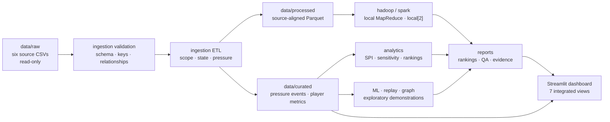
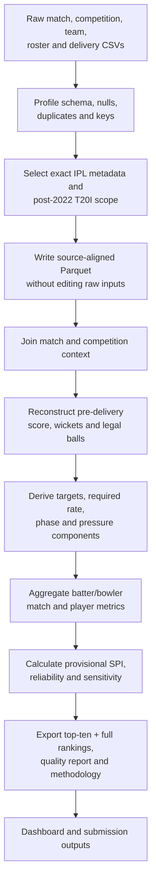
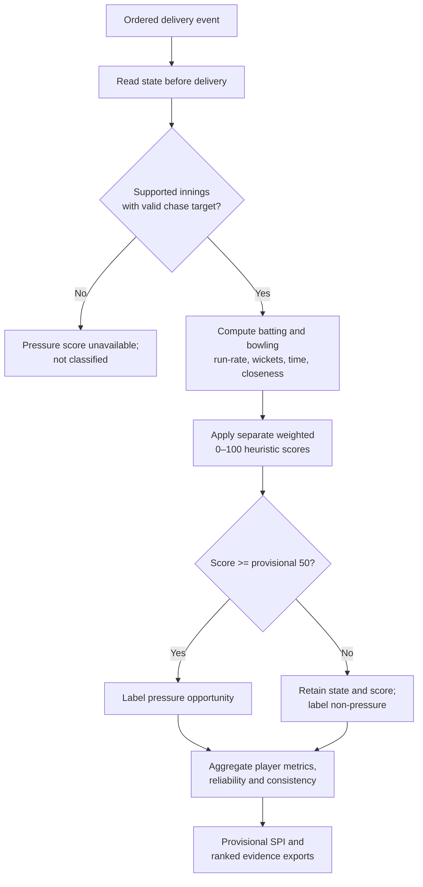

# Architecture and analytical flows

## Project architecture

## Data pipeline

## Pressure classification

## Runtime boundaries

- `reports/streaming/replay_validation.json` is a deterministic historical
  event replay; there is no Kafka broker or connector.
- `databases/` contains Cassandra/HBase query-oriented design and sample
  commands; there is no live NoSQL deployment.
- The graph links only players and matches observed in delivery rows. PageRank
  is a supplementary participation signal and does not enter SPI.
- ML outputs predict delivery boundaries or cluster observed player metrics;
  neither is used in official/provisional ranking calculations.
