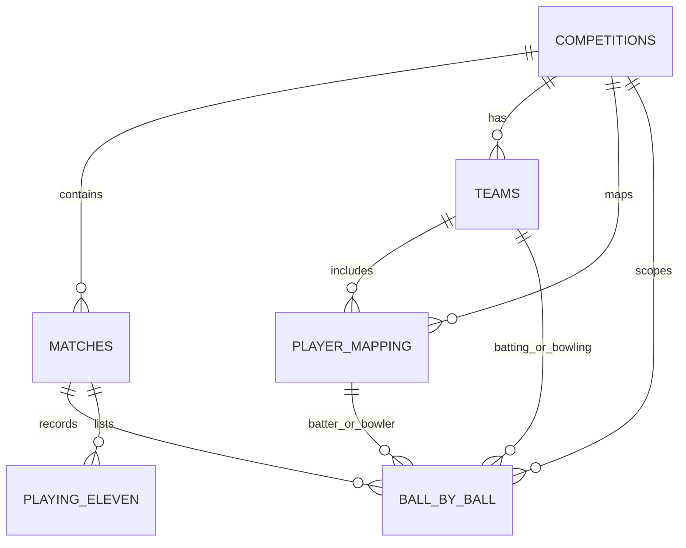

# Dataset Relationships and Lineage

The machine-readable relationship inventory is
[`data/metadata/dataset_relationships.json`](../data/metadata/dataset_relationships.json).



The diagram expresses observed identifier relationships, not every possible
domain relationship. In particular, delivery player/team checks are
competition-scoped and the `playing_eleven` candidate key is not unique.

## Current observations

- Every match references a known competition.
- Every delivery references a known match.
- Every observed delivery batting/bowling team maps within its competition.
- Every observed delivery striker/bowler maps within its competition.
- All 16 matches without delivery rows have result `Match Abandoned`; these are
  metadata-only records, not evidence that the source omitted played innings.
- 35 player/team/match keys repeat in `playing_eleven.csv`; repeated rows have
  multiple batting-order values. They are preserved rather than deduplicated.
- `(match_id, innings, innings_ball_num)` is unique for deliveries, but the
  sequence number includes deliveries that are not legal balls.

## Lineage

```text
data/raw/*.csv (immutable)
  -> data/processed/*.parquet (same source values; no row removal or dedupe)
  -> data/curated/pressure_deliveries.parquet (selected scope + derived match state)
  -> data/curated/*_metrics.parquet (batter, bowler, and match summaries)
  -> reports/final_top10_*.csv (provisional until methodology review)
```

The reproducible command is `.venv/bin/python -m ingestion.run_etl`. The ETL
reports validation warnings rather than concealing or silently fixing them.

